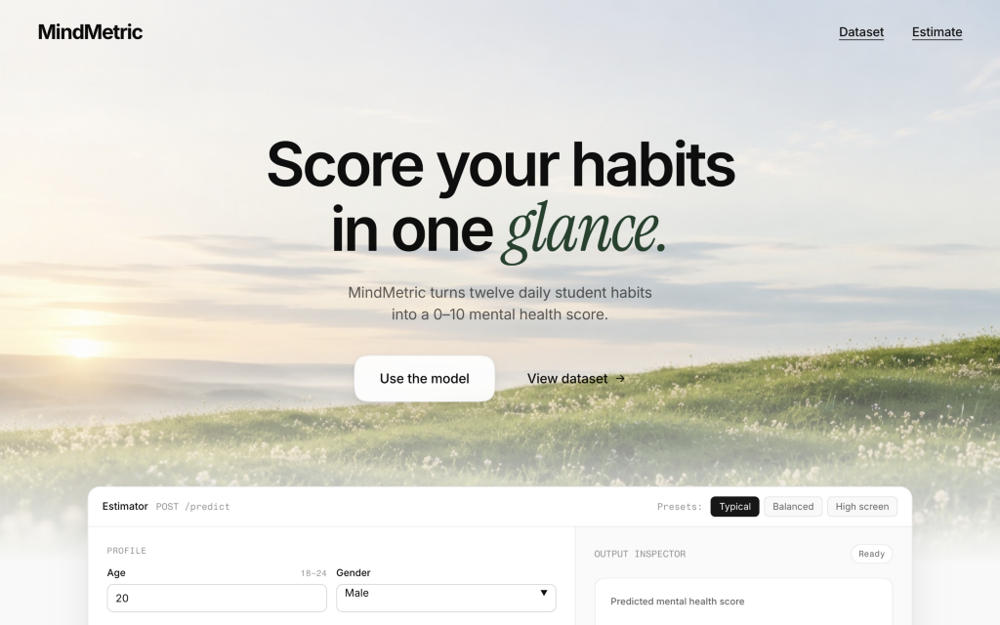
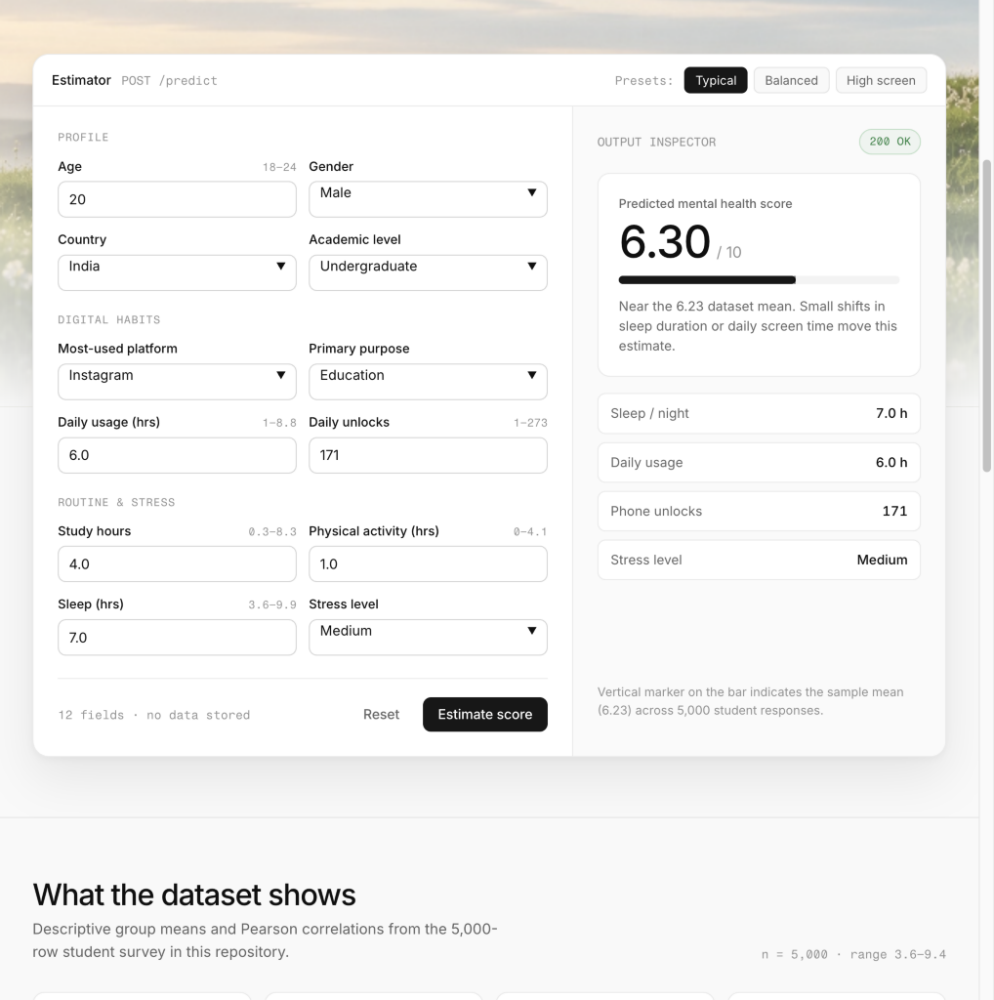
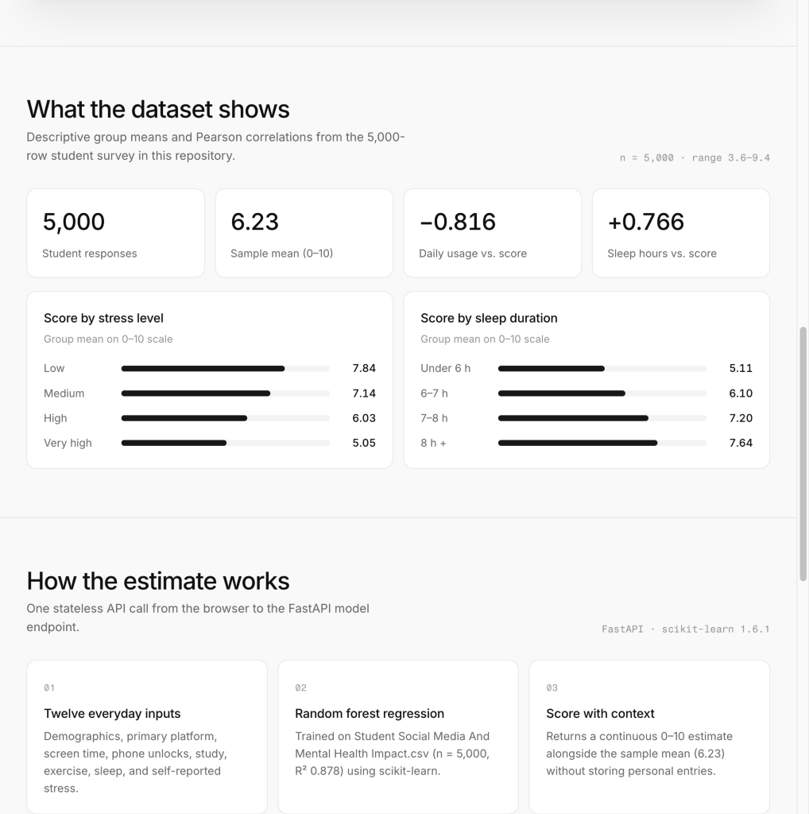

# MindMetric — Student Mental Health Score Estimator

A full-stack machine learning web application that predicts a student's mental health score (`0–10`) from twelve everyday digital and lifestyle habits using a tuned `RandomForestRegressor` pipeline served via **FastAPI** and a **Next.js** frontend.

**Live Application:** [https://mental-health-score-2-1zdy.onrender.com/](https://mental-health-score-2-1zdy.onrender.com/)  
**Prediction API:** `https://mental-health-score-1-b0y6.onrender.com/predict`

> **Disclaimer:** MindMetric provides a statistical survey-based estimate for educational and demonstration purposes only. It is **not** a clinical assessment or diagnostic tool and should not replace professional medical or mental health advice.

---

## Overview & Objective

Excessive screen time, disrupted sleep, and high academic stress often interact in non-linear ways. MindMetric investigates how student social media usage and daily routines relate to self-reported mental health scores, packages the preprocessing and regression model into a single reproducible `scikit-learn` pipeline, and exposes it through a fast, privacy-preserving web interface that stores no user submissions.

---

## Screenshots

### Landing & Hero


### Interactive Estimator Studio (`POST /predict`)


### Dataset Insights & Methodology


---

## Key Features

- **End-to-End Scikit-Learn Pipeline:** Bundles feature transformations, encoding, scaling, and regression in `Mental_Health_Model.pkl` (`scikit-learn==1.6.1`) so training and inference stay identical.
- **Interactive 12-Field Estimator:** Validates inputs against observed survey ranges, supports instant presets (*Typical*, *Balanced*, *High screen*), and renders predictions alongside the `6.23` dataset mean.
- **Stateless FastAPI Backend:** Exposes `POST /predict` with strict Pydantic schema validation, automatic CORS handling, and zero database persistence.
- **Dataset Insights Dashboard:** Visualizes sample correlations and score distributions across stress levels and sleep durations.

---

## Dataset & Attribution

- **Dataset:** `Student Social Media And Mental Health Impact.csv`
- **Source:** [Student Social Media & Mental Health Impact on Kaggle](https://www.kaggle.com/datasets/shivasingh4945/student-social-media-and-mental-health-impact) (uploaded by `shivasingh4945`)
- **License:** [CC BY-SA 4.0 (Creative Commons Attribution-ShareAlike 4.0 International)](https://creativecommons.org/licenses/by-sa/4.0/)
- **Size:** `5,000` raw records (`4,998` after dropping `2` duplicate rows), `12` input features + `1` continuous target (`Mental_Health_Score`, range `3.6–9.4`, mean `6.23`).

### Input Features & Observed Bounds

| Feature | Type | Transformation / Encoding | Observed / Validated Range |
| --- | --- | --- | --- |
| `Age` | Numeric (`int`) | `StandardScaler` | `18` – `24` |
| `Gender` | Nominal (`str`) | `OneHotEncoder` | `Male`, `Female` |
| `Country` | Nominal (`str`) | Top 9 grouped + `Other`, `OneHotEncoder` | `India`, `USA`, `Canada`, `Australia`, `UK`, `Germany`, `Mexico`, `Turkey`, `France`, `Other` |
| `Academic_Level` | Nominal (`str`) | `OneHotEncoder` | `High School`, `Undergraduate`, `Graduate` |
| `Most_Used_Platform` | Nominal (`str`) | `OneHotEncoder` | `Facebook`, `LinkedIn`, `Instagram`, `Snapchat`, `Twitter`, `YouTube`, `TikTok`, `LINE`, `KakaoTalk`, `VKontakte`, `WhatsApp`, `WeChat` |
| `Purpose_Of_Use` | Nominal (`str`) | `OneHotEncoder` | `Networking`, `Education`, `Entertainment`, `News` |
| `Avg_Daily_Usage_Hours` | Numeric (`float`) | `StandardScaler` | `1.0` – `8.8` |
| `Daily_Unlocks` | Numeric (`int`) | `StandardScaler` | `1` – `273` |
| `Study_Hours` | Numeric (`float`) | `log1p` + `StandardScaler` | `0.3` – `8.3` |
| `Physical_Activity_Hours` | Numeric (`float`) | Clipped `>= 0`, `StandardScaler` | `0.0` – `4.1` |
| `Sleep_Hours_Per_Night` | Numeric (`float`) | `StandardScaler` | `3.6` – `9.9` |
| `Stress_Level` | Ordinal (`str`) | `OrdinalEncoder` (`Low < Medium < High < Very High`) | `Low`, `Medium`, `High`, `Very High` |

---

## Machine Learning Pipeline & Evaluation

### 1. Data Preprocessing
In [ML_Project.ipynb](ML_Project.ipynb), the dataset is cleaned (`drop_duplicates()`, `Physical_Activity_Hours.clip(lower=0)`), countries outside the top 9 most frequent values (plus `Other`) are grouped into `'Other'`, and split `70/30` (`random_state=42`) before fitting a `ColumnTransformer`:
- **Skewed numeric (`Study_Hours`):** `FunctionTransformer(np.log1p)` → `StandardScaler`
- **Numeric features:** `StandardScaler`
- **Ordinal feature (`Stress_Level`):** `OrdinalEncoder` preserving `Low < Medium < High < Very High`
- **Nominal features:** `OneHotEncoder(handle_unknown='ignore')`

### 2. Why Random Forest Regression
A `LinearRegression` baseline achieved `Test R² = 0.7398` (`MAE = 0.5362`, `RMSE = 0.6760`), missing non-linear interactions across usage, sleep, and stress bands. `RandomForestRegressor` captures non-linear thresholds across mixed lifestyle habits without manual polynomial engineering.

### 3. Hyperparameter Tuning
Tuned on the training split using 5-fold shuffled cross-validation (`KFold(n_splits=5, shuffle=True, random_state=42)`) and `RandomizedSearchCV(n_iter=24, scoring='r2')`:
- `n_estimators`: `300`
- `max_features`: `'sqrt'`
- `max_depth`: `None`
- `min_samples_split`: `5`
- `min_samples_leaf`: `1`

Using `max_features='sqrt'` prevents a single dominant variable (`Avg_Daily_Usage_Hours`) from dictating every top split, improving generalization and counterfactual stability over the untuned default Random Forest.

### 4. Evaluation Results (Held-Out 30% Test Set)

| Model | Test R² | Test MAE | Test RMSE |
| --- | ---: | ---: | ---: |
| Linear Regression (baseline) | `0.7398` | `0.5362` | `0.6760` |
| **Tuned Random Forest (deployed)** | **`0.8793`** | **`0.3492`** | **`0.4605`** |

---

## Technologies Used

- **Machine Learning & Data:** Python `3.13.5`, `scikit-learn==1.6.1`, `pandas`, `numpy`, `joblib`, Jupyter (`ML_Project.ipynb`)
- **Backend API:** `FastAPI`, `Uvicorn`, `Pydantic`
- **Frontend:** `Next.js 16.4.6` (static export), `React 19.3.1`, `TypeScript 5.9`, `GSAP`, `Lenis`
- **Hosting:** Render (Python Web Service for FastAPI + Static Site for Next.js)

---

## Project Structure

```text
Mental_Health_Score/
├── main.py                                           # FastAPI app & POST /predict endpoint
├── Mental_Health_Model.pkl                           # Tuned RandomForestRegressor pipeline
├── ML_Project.ipynb                                  # EDA, preprocessing, tuning & evaluation
├── Student Social Media And Mental Health Impact.csv # Survey dataset (CC BY-SA 4.0)
├── requirements.txt                                  # Backend Python dependencies
├── .python-version                                   # Pinned Python version (3.13.5)
├── docs/
│   └── screenshots/                                  # Live application screenshots
├── frontend/                                         # Next.js 16 application
│   ├── app/                                          # App Router layout, styles & favicons
│   ├── components/                                   # EstimatorStudio, DatasetSection, FAQSection
│   ├── public/images/                                # Hero background image
│   ├── next.config.mjs                               # Static export configuration
│   └── package.json                                  # Frontend dependencies & scripts
├── index.html                                        # Legacy static frontend (retained)
├── script.js
└── style.css
```

---

## Installation & Local Execution

### 1. Backend (FastAPI)

```bash
git clone https://github.com/riturajthakur1/Mental_Health_Score.git
cd Mental_Health_Score

pip install -r requirements.txt
uvicorn main:app --reload --port 8000
```

- Health check: `GET http://localhost:8000/` → `["Welcome to my project"]`
- Interactive Swagger docs: `http://localhost:8000/docs`

### 2. Frontend (Next.js)

In a separate terminal:

```bash
cd Mental_Health_Score/frontend
npm install
npm run dev
```

Open `http://localhost:3000` in your browser. By default, the frontend sends requests to `http://localhost:8000/predict`. To point it to a deployed API instead, create `frontend/.env.local`:

```env
NEXT_PUBLIC_API_URL=https://mental-health-score-1-b0y6.onrender.com/predict
```

---

## API Reference

### `POST /predict`

Accepts a JSON payload of the 12 student attributes and returns:

```json
{
  "predicted_mental_health_score": 6.3
}
```

---

## Limitations & Disclaimer

- **Survey & Synthetic Correlation Structure:** Predictions reflect patterns within the 5,000-row survey dataset (`Student Social Media And Mental Health Impact.csv`) where lifestyle habits are strongly correlated. Unusual or out-of-distribution combinations (e.g., very low screen time paired with extreme sleep deprivation) should be interpreted cautiously.
- **Input Bounds:** Inputs are constrained to the dataset's observed ranges (ages `18–24`, daily usage `1.0–8.8h`, sleep `3.6–9.9h`) to avoid unbounded extrapolation.
- **Non-Clinical Use:** MindMetric is an educational ML project and **not** a medical or psychological screening instrument.

---

## Author

**Rituraj Thakur**  
- GitHub: [riturajthakur1](https://github.com/riturajthakur1)  
- LinkedIn: [rituraj-thakur](https://www.linkedin.com/in/rituraj-thakur/)
